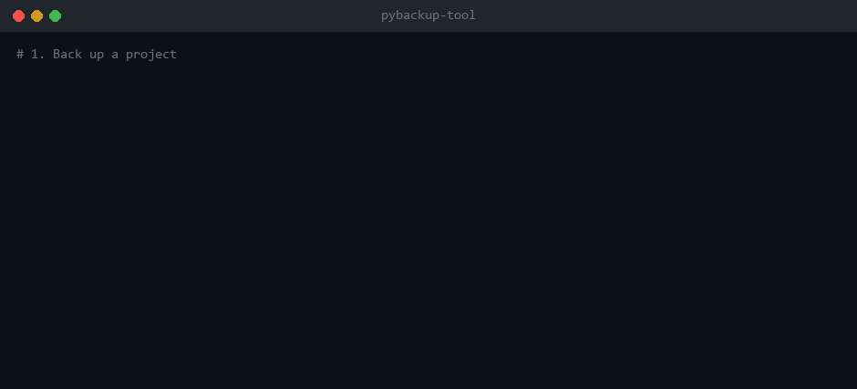
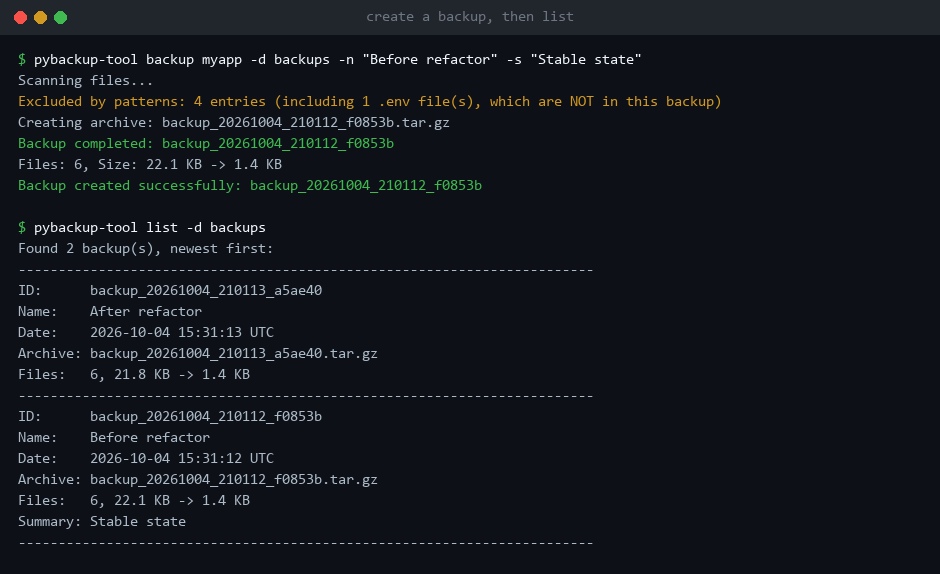
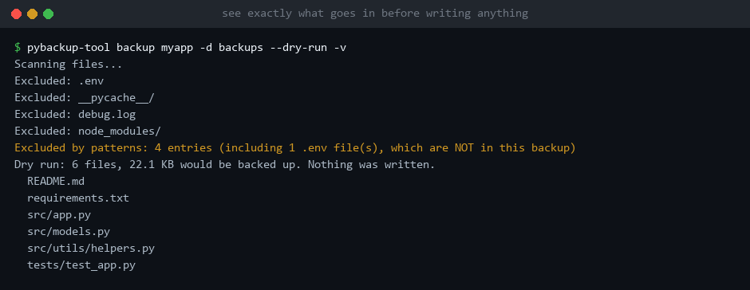
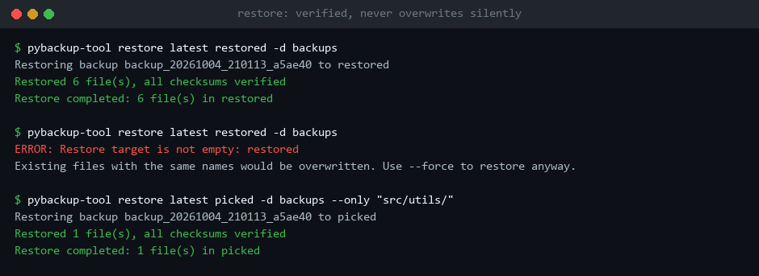
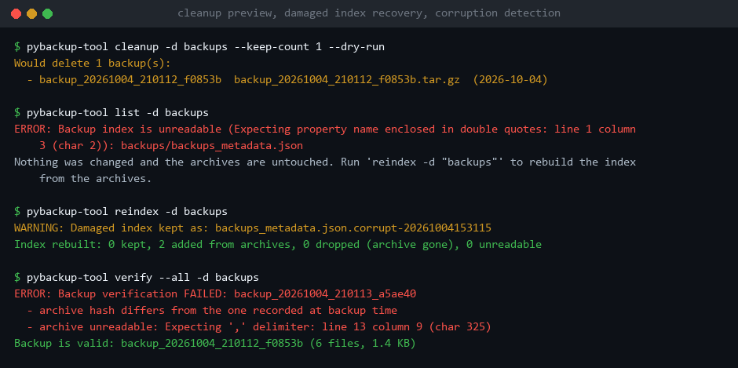

# PyBackup-Tool


Snapshot a codebase into a verified archive, and get it back intact. One command to back up, one to restore, nothing to install besides Python.



## What it does

- **Backs up a project** into a single `tar.gz` (or `tar.xz`, `tar.bz2`, `tar`) with a name, a summary and a timestamp.
- **Hashes every file** (SHA-256) while it is being archived and stores the hashes inside the archive.
- **Verifies** a backup at any time, and again automatically on every restore.
- **Restores safely**: never writes outside the target directory, never overwrites existing files unless you say so.
- **Filters** with `.gitignore`-style include and exclude patterns.
- **Remembers settings per project** in a `.pybackup.json` you can commit.
- **Cleans up old backups** only when asked, and always keeps the newest one.

It uses the Python standard library only. Works on Windows, Linux and macOS with Python 3.8 or newer.

## Contents

- [Install](#install)
- [Quick start](#quick-start)
- [A tour in screenshots](#a-tour-in-screenshots)
- [Commands](#commands)
- [Project config file](#project-config-file)
- [Patterns](#patterns)
- [How your data is protected](#how-your-data-is-protected)
- [What is stored where](#what-is-stored-where)
- [Using it from scripts](#using-it-from-scripts)
- [Upgrading from 1.x](#upgrading-from-1x)
- [Development](#development)

## Install

```bash
pip install git+https://github.com/ByteStackr/PyBackup-Tool.git
```

This gives you the `pybackup-tool` command. Releases are also published to PyPI as `PyBackup-Tool`; `pip install PyBackup-Tool` gets the latest released version, which may be older than this repository.

No install at all also works: clone the repository and run the launcher.

```bash
git clone https://github.com/ByteStackr/PyBackup-Tool.git
python PyBackup-Tool/PyBackup_Tool.py --help
```

Everywhere below, `pybackup-tool` and `python PyBackup_Tool.py` are interchangeable.

## Quick start

**One-off backup of a directory**

```bash
pybackup-tool backup ./myapp -d ./backups -n "Before refactor"
pybackup-tool list -d ./backups
pybackup-tool restore latest ./myapp-restored -d ./backups
```

**Per-project setup (recommended)**

```bash
cd myapp
pybackup-tool init-config     # writes .pybackup.json
pybackup-tool backup          # uses it
pybackup-tool list            # the destination comes from the config too
```

`.pybackup.json` is found from any subdirectory of the project, so `pybackup-tool backup` works wherever you are inside it.

## A tour in screenshots

### Create a backup, then list

Every backup gets an ID. Anywhere an ID is expected you can also write `latest`, the start of an ID, or the archive file name.



The orange line is deliberate: `.env` files are excluded by default because they usually hold secrets, and the tool tells you so instead of leaving them out silently. Remove `.env` from `exclude_patterns` if you want them in.

### Preview before writing anything

`--dry-run` shows what would be backed up. Add `-v` to list every file and every excluded path.



### Restore

A restore checks the archive hash first and every file hash afterwards. It refuses to write into a directory that already has content unless you pass `--force`. `--only` restores a subset.



### Cleanup preview, index recovery, corruption detection

`cleanup --dry-run` shows what would be deleted. If the index file is damaged, the tool stops instead of guessing, and `reindex` rebuilds it from the archives. `verify` pinpoints a corrupted archive.



## Commands

`-v` (verbose) and `-q` (quiet) work before or after any command. `-d DIR` is the backup directory; when omitted, the destination of the project config is used, then the global default.

| Command | What it does |
|---|---|
| `backup [SOURCE ...]` | Create a backup. Without sources it uses `.pybackup.json`. |
| `list` | List backups, newest first. `--format table\|json\|simple` |
| `restore ID TARGET` | Restore a backup into `TARGET`. |
| `verify ID` / `verify --all` | Check the archive hash and every file hash. |
| `add-summary ID "text"` | Set or replace the summary of a backup. |
| `cleanup` | Delete old backups by count and/or age. |
| `reindex` | Rebuild the index from the archives in the destination. |
| `configure` | Show or change global settings. |
| `init-config` | Write a sample `.pybackup.json`. |

### backup

```bash
pybackup-tool backup                                    # from .pybackup.json
pybackup-tool backup --config path/to/config.json
pybackup-tool backup ./src ./docs -d ./backups          # several sources
pybackup-tool backup ./src -d ./backups --exclude "*.log" --exclude "tmp/"
pybackup-tool backup ./src -d ./backups --format tar.xz --level 9
```

| Option | Meaning |
|---|---|
| `-n NAME`, `-s TEXT` | Name and summary shown by `list`. |
| `--include PATTERN` | Repeatable. Default: everything. |
| `--exclude PATTERN` | Repeatable. Replaces the default excludes. |
| `--format` | `tar.gz` (default), `tar.xz`, `tar.bz2`, `tar`. |
| `--level 0-9` | Compression level, default 6. |
| `--dry-run` | Show what would be backed up, write nothing. |
| `--verify` | Re-read the finished archive and check every hash. |
| `--allow-partial` | Exit 0 even if some files could not be read. |

With several sources, each one becomes a top-level folder in the archive. `--include`, `--exclude`, `--format`, `--level` and `-d` belong to command-line backups; with a project config, set them in the file.

### restore

```bash
pybackup-tool restore latest ./restored -d ./backups
pybackup-tool restore backup_20250906_143022_abc123 ./restored -d ./backups
pybackup-tool restore latest ./restored -d ./backups --only "src/" --only "*.md"
pybackup-tool restore latest ./myapp -d ./backups --force      # into existing files
```

`--no-verify` skips the hash checks; use it only to salvage what is readable from a damaged archive.

### cleanup

```bash
pybackup-tool cleanup -d ./backups --keep-count 5             # keep the newest 5
pybackup-tool cleanup -d ./backups --max-age 30               # delete older than 30 days
pybackup-tool cleanup -d ./backups --max-age 30 --dry-run     # preview
```

The newest complete backup is never deleted, whatever the age limit says. Raise that floor with `--min-keep N`.

### configure

```bash
pybackup-tool configure                                  # show settings
pybackup-tool configure --default-destination ~/backups
pybackup-tool configure --auto-cleanup on --max-backups 15
```

Global settings live in `~/.pybackup_config.json` and apply to backups made without a project config. Automatic cleanup is off unless you turn it on.

## Project config file

`pybackup-tool init-config` writes a file like this one. Every key is optional.

```json
{
    "backup_name": "MyProject Backup",
    "source_paths": ["."],
    "destination": "./backups",
    "filename_format": "{YYYY-MM-DD}_{project_name}_v{SrNo}",
    "archive_format": "tar.gz",
    "compression_level": 6,
    "include_patterns": ["*"],
    "exclude_patterns": [".git/", "node_modules/", "__pycache__/", "*.pyc", ".env", ".env.*", "*.log"],
    "auto_cleanup": {
        "enabled": false,
        "max_backups": 10,
        "max_age_days": null,
        "min_keep": 1
    },
    "summary": {
        "default_summary": "Automated backup of {project_name}"
    }
}
```

| Key | Meaning |
|---|---|
| `backup_name` | Name shown by `list`. |
| `source_paths` | Directories or files to back up, relative to the config file. |
| `destination` | Where archives go, relative to the config file. It is never backed up into itself. |
| `filename_format` | Archive name template, see below. An existing archive is never overwritten; a clash gets `_2`, `_3`, ... |
| `archive_format` | `tar.gz`, `tar.xz`, `tar.bz2` or `tar`. |
| `compression_level` | 0 (fastest) to 9 (smallest). |
| `include_patterns`, `exclude_patterns` | See [Patterns](#patterns). |
| `auto_cleanup` | Runs after each successful backup when `enabled` is true. Skipped if the backup was incomplete. |
| `summary.default_summary` | Summary template; `-s` on the command line overrides it. |
| `project_name` | Value of `{project_name}`. Default: the folder holding the config. |

Keys starting with `_` are ignored, so they can serve as comments. A fuller example is in [example_pybackup.json](example_pybackup.json).

### File name variables

| Variable | Example |
|---|---|
| `{YYYY-MM-DD}` | `2025-09-06` |
| `{DDMMYY}` / `{YYMMDD}` | `060925` / `250906` |
| `{HH-MM-SS}` | `14-30-22` |
| `{timestamp}` | `1757169022` |
| `{SrNo}` or `{counter}` | `1`, `2`, `3`, ... per destination |
| `{project_name}` | `myapp` |
| `{branch}` | current git branch, or `no-branch` |

`"{project_name}_{YYYY-MM-DD}_v{SrNo}"` produces `myapp_2025-09-06_v1.tar.gz`. A misspelled variable is reported as an error.

## Patterns

Patterns follow `.gitignore` conventions.

| Pattern | Matches |
|---|---|
| `*.log` | Any file or folder named like that, at any depth. |
| `node_modules/` | Any folder with that name, at any depth, and everything in it. |
| `docs/*.md` | Markdown files directly in the top-level `docs` folder. A pattern containing `/` is anchored to the source root. |
| `src/**/*.py` | Python files anywhere below `src`. `**` crosses folders, `*` does not. |
| `src/` | As an include: everything below `src`. |
| `*.{js,ts}` | Either extension. |
| `file[0-9].txt` | Character classes. |
| `!.env.example` | In excludes only: re-include a file excluded by an earlier pattern. |

Rules:

1. A file is backed up if it matches an include pattern and no exclude pattern. Excludes win.
2. An excluded folder is never entered, so nothing inside it can be re-included. Write `.vscode/*` followed by `!.vscode/settings.json`, not `.vscode/`.
3. On Windows, matching ignores case.
4. Symlinks are stored as links and not followed.

Default excludes: `.git/`, `node_modules/`, `__pycache__/`, `*.pyc`, `*.pyo`, `*.pyd`, `.env`, `.env.*`, `*.log`, `*.tmp`, `.DS_Store`, `Thumbs.db`, `*.swp`, `*.swo`, `.vscode/`, `.idea/`.

## How your data is protected

| Risk | What the tool does |
|---|---|
| A file cannot be read during backup | The backup is marked incomplete, the file is named on stderr, the exit code is 2. Never a silent gap. |
| A file shrinks or fails mid-read | Same as above; the damaged copy is not restored. |
| Crash or Ctrl+C mid-backup | Archives and the index are written to a temporary file and renamed when complete. No truncated files are left behind. |
| Damaged index file | Commands stop with an error instead of starting an empty index over it. `reindex` rebuilds it; the damaged file is kept, renamed. |
| Bit rot in an archive | `verify` and `restore` compare the archive hash and every file hash. |
| Hostile or broken archive | Restore rejects absolute paths, `..`, hard links, device files, and symlinks leaving the target. |
| Restoring over existing work | Refused unless `--force`. |
| Two backups running at once | A lock file in the destination makes the second one stop. |
| Overeager cleanup | Off by default, previewable with `--dry-run`, never deletes the newest complete backup, never runs after an incomplete backup. |
| Backing up the backups | The destination directory is always skipped, wherever it is. |

Not included: encryption and incremental backups. Each backup is a full, plain archive that any `tar` can open.

## What is stored where

```
backups/
├── backups_metadata.json                    index: one summary entry per backup
├── backup_20250906_143022_abc123.tar.gz     archive
└── 2025-09-06_myapp_v2.tar.gz               archive named by filename_format
```

Each archive ends with `.pybackup-manifest.json`, which lists every file with its size and SHA-256, the backup's name, summary, time and patterns, and any file that could not be backed up. Because the manifest travels inside the archive, a single archive file is enough to verify and restore, and enough for `reindex` to rebuild the index.

The index keeps only summaries, so it stays small however many files you back up:

```json
{
    "id": "backup_20250906_143022_abc123",
    "timestamp": "2025-09-06T14:30:22+00:00",
    "name": "Before refactor",
    "summary": "Stable state",
    "archive_name": "backup_20250906_143022_abc123.tar.gz",
    "archive_sha256": "9f2c...",
    "file_count": 1247,
    "total_size": 52428800,
    "compressed_size": 12582912,
    "partial": false
}
```

## Using it from scripts

Exit codes: `0` success, `1` error, `2` backup written but incomplete.

```bash
#!/bin/sh
# Nightly backup with a verification pass; cron mails any output on failure.
cd /path/to/project || exit 1
pybackup-tool -q backup --verify || echo "backup problem, exit code $?"
pybackup-tool -q cleanup --keep-count 14 --max-age 90
```

Attach a summary afterwards, for example one generated by another tool:

```bash
pybackup-tool add-summary latest "Added payment integration" -d ./backups
```

Machine-readable listing:

```bash
pybackup-tool list -d ./backups --format json
```

From Python:

```python
from pybackuptool import BackupManager

manager = BackupManager()
result = manager.create_backup("./myapp", "./backups", name="From Python")
print(result["id"], result["file_count"], result["partial"])
manager.restore_backup(result["id"], "./backups", "./restored")
```

## Upgrading from 1.x

Backups made by 1.x still list, verify and restore. Things that behave differently:

| 1.x | 2.0 |
|---|---|
| Old backups were deleted automatically (10 kept) | Nothing is deleted unless cleanup is enabled or run. |
| `filename_format` was ignored | It names the archive. |
| Only the first `source_paths` entry was used | All are backed up. |
| `compression_level` was ignored (always 9) | It is applied. |
| Include patterns such as `src/**/*` or `*.py` skipped subfolders | They match as documented. |
| Unreadable files produced a warning and exit code 0 | Exit code 2, backup marked incomplete. |
| Restore overwrote existing files | Needs `--force`. |
| `source_paths` were relative to the current directory | Relative to the config file. |
| `init-config` asked before overwriting | Use `--force`. |
| `generate_checksums` option | Ignored; hashing is always on and costs no extra read. |
| Python 3.6+ | Python 3.8+. |
| Single file `PyBackup_Tool.py` | Package `pybackuptool`; `PyBackup_Tool.py` remains as a launcher. |

## Development

```bash
python -m unittest discover -s test -v     # run the tests
python docs/make_demo.py                   # regenerate README images (needs Pillow)
```

The code is in `pybackuptool/`: `filters.py` (patterns and scanning), `archive.py` (writing, verifying, extracting), `metadata.py` (index and lock), `config.py` (settings and config files), `manager.py` (operations), `cli.py` (command line).

## License

MIT. See [LICENSE](LICENSE).
